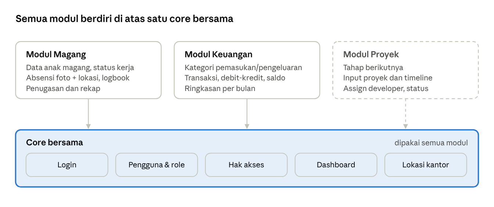
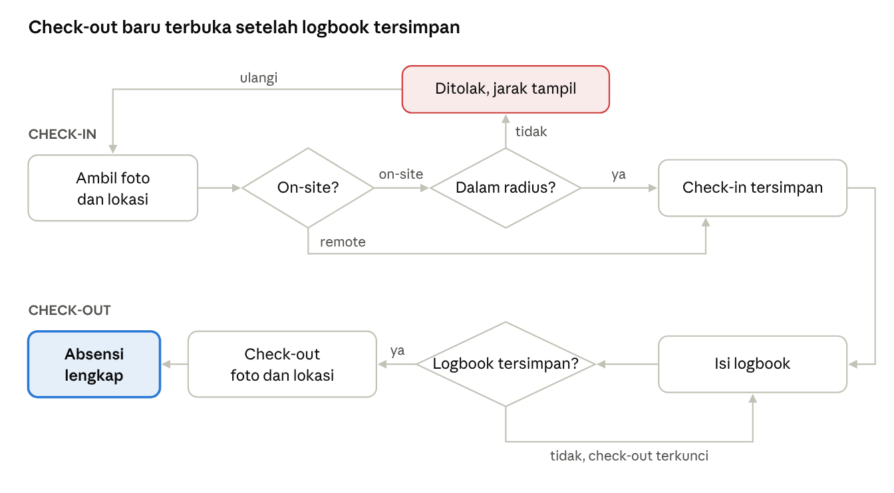

**PRODUCT REQUIREMENTS DOCUMENT (PRD)**

**Sistem Informasi Manajemen Magang dan Keuangan Metro Software**

# Ringkasan Produk

Produk ini adalah aplikasi web untuk Metro Software yang berisi dua modul pada tahap 1: Manajemen Magang dan Manajemen Keuangan. Keduanya berjalan di atas satu core bersama (login, pengguna, hak akses, dan dashboard), sehingga modul lain dapat ditambahkan di tahap berikutnya. Dokumen ini menjadi acuan bagi tim UI/UX, backend, frontend, dan QA selama proyek berlangsung (11 Oktober–14 November 2026).

## Masalah

Berdasarkan wawancara dengan pihak Metro Software:

- Belum ada absensi untuk anak magang.

- Anak magang tidak mengisi logbook dan tidak melaporkan progres tugasnya, sehingga tugas yang ditargetkan selesai dalam dua minggu kadang belum selesai saat dicek.

- Admin belum punya satu tempat untuk melihat daftar anak magang, periode magangnya, dan progres pekerjaannya.

- Pimpinan butuh ringkasan jumlah anak magang serta total pemasukan dan pengeluaran bulan berjalan. Cara pencatatan keuangan yang dipakai saat ini belum dijelaskan oleh narasumber.

## Tujuan

1.  Mencatat kehadiran anak magang secara digital, lengkap dengan waktu, foto wajah, dan lokasi.

2.  Memastikan setiap hari kerja anak magang memiliki logbook.

3.  Memudahkan admin memantau anak magang dan tugasnya dari satu halaman.

4.  Mencatat pemasukan dan pengeluaran per kategori dengan saldo yang dihitung otomatis.

5.  Menyediakan dashboard ringkas untuk pimpinan.

## Cakupan Tahap 1

| **Bagian**     | **Isi**                                                                                        |
|----------------|------------------------------------------------------------------------------------------------|
| Core           | Login, pengelolaan pengguna, role dan hak akses per modul, dashboard, pengaturan lokasi kantor |
| Modul Magang   | Data anak magang, status on-site/remote, absensi, logbook, penugasan, rekap                    |
| Modul Keuangan | Kategori transaksi, pencatatan transaksi, tabel debit-kredit dan saldo, ringkasan keuangan     |

# Pengguna dan Hak Akses

Tahap 1 memiliki dua role, sesuai keterangan narasumber bahwa modul magang butuh role admin dan anak magang, sedangkan modul keuangan cukup role admin. Pimpinan melihat dashboard menggunakan akun Admin.

| **Role**    | **Siapa**                                         | **Kebutuhan utama**                                                                              |
|-------------|---------------------------------------------------|--------------------------------------------------------------------------------------------------|
| Admin       | Pengelola operasional dan pimpinan Metro Software | Memantau anak magang, mengatur status kerja, memberi tugas, mencatat keuangan, melihat dashboard |
| Anak Magang | Mahasiswa yang sedang magang, on-site atau remote | Absen setiap hari, mengisi logbook, melihat dan memperbarui tugasnya                             |

## Matriks Hak Akses

| **Fitur**                                     | **Admin** | **Anak Magang** |
|-----------------------------------------------|-----------|-----------------|
| Dashboard ringkasan perusahaan                | Ya        | Tidak           |
| Dashboard pribadi (absensi dan tugas sendiri) | Tidak     | Ya              |
| Pengelolaan pengguna dan role                 | Ya        | Tidak           |
| Pengaturan lokasi dan radius kantor           | Ya        | Tidak           |

# Arsitektur Modular dan Navigasi

Setiap modul hanya berisi fitur bisnisnya sendiri, sedangkan login, pengguna, hak akses, dashboard, dan pengaturan lokasi disediakan oleh core. Modul tidak boleh mengakses tabel milik modul lain secara langsung.

*Gambar 1. Arsitektur modular (1 core, 2 modul tahap 1, 1 modul rencana)*

Modul Proyek digambar putus-putus karena baru direncanakan untuk tahap berikutnya.

## Struktur Sidebar

Sidebar dibangun dari daftar menu yang didaftarkan setiap modul, lalu disaring sesuai hak akses role. Menambah modul baru cukup dengan mendaftarkan menunya, tanpa mengubah layout.

| **Grup Menu**      | **Admin**                                     | **Anak Magang**              |
|--------------------|-----------------------------------------------|------------------------------|
| Dashboard          | Dashboard                                     | Dashboard Saya               |
| Manajemen Magang   | Data Anak Magang, Absensi, Logbook, Penugasan | Absensi, Logbook, Tugas Saya |
| Manajemen Keuangan | Transaksi, Kategori, Ringkasan Keuangan       | Tidak tampil                 |
| Pengaturan         | Pengguna dan Role, Lokasi Kantor              | Profil                       |

# Kebutuhan Fungsional

Setiap kebutuhan diberi kode agar mudah dirujuk di desain, kode program, dan test case black box. Prioritas **Wajib** harus selesai di tahap 1, sedangkan **Sebaiknya** dikerjakan jika waktu cukup.

## Core

| **Kode** | **User Story**                                                                                                                                                        | **Kriteria Penerimaan**                                                                                                                         | **Prioritas** |
|----------|-----------------------------------------------------------------------------------------------------------------------------------------------------------------------|-------------------------------------------------------------------------------------------------------------------------------------------------|---------------|
| CR-01    | Sebagai pengguna, saya ingin login dengan email dan password agar dapat memakai fitur sesuai role saya.                                                               | Login berhasil diarahkan ke dashboard sesuai role. Login gagal menampilkan pesan tanpa menyebut bagian mana yang salah. Tersedia tombol logout. | Wajib         |
| CR-02    | Sebagai admin, saya ingin menambah, mengubah, dan menonaktifkan akun pengguna agar hanya orang yang berhak yang bisa masuk.                                           | Email tidak boleh sama dengan akun lain. Akun nonaktif tidak bisa login.                                                                        | Wajib         |
| CR-03    | Sebagai admin, saya ingin mengatur hak akses setiap role per modul agar modul baru bisa diberikan ke role tertentu.                                                   | Sidebar hanya menampilkan modul yang diizinkan. Membuka halaman tanpa izin lewat URL ditolak oleh backend.                                      | Wajib         |
| CR-04    | Sebagai admin, saya ingin melihat dashboard berisi jumlah anak magang aktif serta total pemasukan dan pengeluaran bulan ini agar kondisi perusahaan terlihat sekilas. | Angka di dashboard sama dengan data di masing-masing modul. Setiap modul menampilkan kartu ringkasannya sendiri.                                | Wajib         |
| CR-05    | Sebagai admin, saya ingin mengatur titik koordinat dan radius kantor agar validasi absensi on-site sesuai lokasi Metro.                                               | Radius diisi dalam meter dan bisa diubah kapan saja. Perubahan berlaku untuk absensi berikutnya.                                                | Wajib         |

## Modul Magang

| **Kode** | **User Story**                                                                                                                                             | **Kriteria Penerimaan**                                                                                                                                  | **Prioritas** |
|----------|------------------------------------------------------------------------------------------------------------------------------------------------------------|----------------------------------------------------------------------------------------------------------------------------------------------------------|---------------|
| MG-01    | Sebagai admin, saya ingin mengelola data anak magang (nama, asal kampus, email, tanggal mulai, tanggal selesai) agar periode magang setiap orang tercatat. | Tanggal selesai tidak boleh sebelum tanggal mulai. Menambah anak magang sekaligus membuat akun loginnya.                                                 | Wajib         |
| MG-02    | Sebagai admin, saya ingin menetapkan status kerja anak magang (on-site atau remote) agar aturan absensinya sesuai.                                         | Status tampil di data anak magang dan berlaku untuk absensi berikutnya.                                                                                  | Wajib         |
| MG-03    | Sebagai anak magang, saya ingin check-in dengan foto wajah dan lokasi agar kehadiran saya tercatat.                                                        | Tombol simpan tidak aktif sebelum foto diambil. Anak magang on-site di luar radius ditolak dengan pesan jarak ke kantor. Check-in hanya sekali per hari. | Wajib         |
| MG-04    | Sebagai anak magang, saya ingin mengisi logbook harian agar pekerjaan saya hari itu tercatat.                                                              | Logbook tidak boleh kosong. Logbook masih bisa diubah sebelum check-out.                                                                                 | Wajib         |
| MG-05    | Sebagai anak magang, saya ingin check-out dengan foto wajah dan lokasi di akhir hari.                                                                      | Tombol check-out terkunci sampai logbook hari itu tersimpan. Check-out hanya bisa dilakukan setelah check-in.                                            | Wajib         |
| MG-06    | Sebagai admin, saya ingin memberikan tugas (judul, deskripsi, tenggat waktu) kepada anak magang.                                                           | Tugas langsung muncul di halaman anak magang yang dituju.                                                                                                | Wajib         |
| MG-07    | Sebagai anak magang, saya ingin memperbarui status tugas (Belum Dikerjakan, Dikerjakan, Selesai) beserta catatan progres.                                  | Admin melihat status terbaru. Tugas yang melewati tenggat dan belum selesai ditandai Terlambat.                                                          | Wajib         |
| MG-08    | Sebagai anak magang, saya ingin melihat daftar tugas, tenggat waktu, dan tanggal berakhir magang saya.                                                     | Halaman menampilkan sisa hari masa magang.                                                                                                               | Wajib         |
| MG-09    | Sebagai admin, saya ingin melihat rekap absensi dan logbook per anak magang dan per periode.                                                               | Rekap menampilkan jam, foto, dan lokasi. Hari tanpa check-out ditandai otomatis.                                                                         | Wajib         |
| MG-10    | Sebagai admin, saya ingin mengoreksi data absensi dengan keterangan, misalnya saat sistem tidak bisa diakses.                                              | Setiap koreksi menyimpan keterangan dan nama admin yang mengubah.                                                                                        | Sebaiknya     |

## Modul Keuangan

| **Kode** | **User Story**                                                                                                                                 | **Kriteria Penerimaan**                                                                                                             | **Prioritas** |
|----------|------------------------------------------------------------------------------------------------------------------------------------------------|-------------------------------------------------------------------------------------------------------------------------------------|---------------|
| KU-01    | Sebagai admin, saya ingin mengelola kategori pemasukan (misalnya penjualan jasa) dan pengeluaran (misalnya gaji karyawan, operasional kantor). | Kategori dibedakan menurut jenis. Kategori yang sudah dipakai transaksi tidak bisa dihapus, hanya dinonaktifkan.                    | Wajib         |
| KU-02    | Sebagai admin, saya ingin mencatat transaksi berisi tanggal, jenis, kategori, nominal, dan keterangan.                                         | Nominal harus lebih dari 0. Pilihan kategori menyesuaikan jenis transaksi.                                                          | Wajib         |
| KU-03    | Sebagai admin, saya ingin mengubah atau menghapus transaksi yang salah input.                                                                  | Sistem meminta konfirmasi sebelum menghapus. Transaksi yang dihapus tidak hilang dari database dan tetap tersimpan sebagai riwayat. | Wajib         |
| KU-04    | Sebagai admin, saya ingin melihat transaksi dalam tabel debit dan kredit beserta saldo.                                                        | Transaksi urut tanggal dengan saldo berjalan. Saldo akhir sama dengan total pemasukan dikurangi total pengeluaran.                  | Wajib         |
| KU-05    | Sebagai admin, saya ingin melihat ringkasan keuangan per bulan.                                                                                | Bisa difilter per bulan. Menampilkan total pemasukan, total pengeluaran, saldo, dan rincian per kategori.                           | Wajib         |

# Alur Absensi Harian

Alur ini menggabungkan MG-03, MG-04, dan MG-05 serta aturan BR-01 sampai BR-05.

*Gambar 2. Alur absensi harian anak magang (check-in, logbook, check-out)*

Check-out memakai aturan yang sama dengan check-in: foto wajib, dan anak magang on-site harus berada dalam radius kantor. Agar gambar tetap ringkas, pengecekan radius saat check-out tidak digambar ulang.

# Aturan Bisnis

Aturan ini berlaku di backend, bukan hanya di tampilan, sehingga tidak bisa dilewati dengan mengubah request.

| **Kode** | **Aturan**                                                                                                                                                                         |
|----------|------------------------------------------------------------------------------------------------------------------------------------------------------------------------------------|
| BR-01    | Anak magang **on-site** hanya bisa check-in dan check-out jika jarak lokasinya ke titik kantor tidak melebihi radius yang diatur admin. Jarak dihitung dari koordinat GPS browser. |
| BR-02    | Anak magang **remote** boleh check-in dan check-out dari lokasi mana pun, tetapi lokasi tetap dicatat.                                                                             |
| BR-03    | Foto wajah wajib diambil langsung dari kamera saat check-in dan check-out. Unggah file dari galeri tidak diizinkan.                                                                |
| BR-04    | Setiap anak magang hanya bisa check-in satu kali dan check-out satu kali per hari.                                                                                                 |
| BR-05    | Check-out hanya bisa dilakukan setelah check-in dan setelah logbook hari itu tersimpan.                                                                                            |
| BR-06    | Hanya admin yang bisa mengubah status on-site atau remote.                                                                                                                         |
| BR-07    | Anak magang yang tanggal selesai magangnya sudah lewat tidak bisa lagi melakukan absensi, tetapi datanya tetap tersimpan untuk rekap.                                              |
| BR-08    | Tugas yang melewati tenggat dan belum berstatus Selesai otomatis ditandai Terlambat.                                                                                               |
| BR-09    | Saldo = total pemasukan dikurangi total pengeluaran, dihitung dari transaksi yang tidak dihapus.                                                                                   |
| BR-10    | Transaksi yang dihapus disimpan sebagai riwayat (soft delete) dan tidak dihitung dalam saldo.                                                                                      |
| BR-11    | Nominal transaksi wajib lebih dari 0. Jenis transaksi (pemasukan atau pengeluaran) menentukan apakah nominal menambah atau mengurangi saldo.                                       |

# Data Utama

Tabel berikut adalah titik awal untuk ERD. Nama tabel diberi awalan per modul (*core\_*, *mg\_*, *ku\_*) agar batas antar modul terlihat jelas di database.

| **Tabel**             | **Atribut utama**                                                                                                                                                        | **Modul** |
|-----------------------|--------------------------------------------------------------------------------------------------------------------------------------------------------------------------|-----------|
| core_users            | id, nama, email, password_hash, role_id, aktif                                                                                                                           | Core      |
| core_roles            | id, nama                                                                                                                                                                 | Core      |
| core_role_permissions | role_id, permission (kode seperti magang:absen atau keuangan:kelola)                                                                                                     | Core      |
| core_office_settings  | latitude, longitude, radius_meter                                                                                                                                        | Core      |
| mg_interns            | id, user_id, asal_kampus, tanggal_mulai, tanggal_selesai, status_kerja (on-site/remote)                                                                                  | Magang    |
| mg_attendances        | id, intern_id, tanggal, jam_checkin, foto_checkin, lat_checkin, lng_checkin, jam_checkout, foto_checkout, lat_checkout, lng_checkout, keterangan_koreksi, dikoreksi_oleh | Magang    |
| mg_logbooks           | id, intern_id, tanggal, isi                                                                                                                                              | Magang    |
| mg_tasks              | id, intern_id, judul, deskripsi, tenggat, status, catatan_progres, dibuat_oleh                                                                                           | Magang    |
| ku_categories         | id, nama, jenis (pemasukan/pengeluaran), aktif                                                                                                                           | Keuangan  |
| ku_transactions       | id, tanggal, jenis, category_id, nominal, keterangan, dibuat_oleh, deleted_at                                                                                            | Keuangan  |

File foto disimpan di Railway Volume (path dari variabel *UPLOAD_DIR*) dan tidak bisa diakses publik. Tabel *mg_attendances* hanya menyimpan nama file atau path-nya.

# Kebutuhan Non-Fungsional

Target di kolom ketiga adalah usulan tim agar setiap poin bisa diuji. Angkanya dapat disesuaikan setelah dibahas bersama.

| **Kode** | **Kebutuhan** | **Target yang diuji**                                                                                   |
|----------|---------------|---------------------------------------------------------------------------------------------------------|
| NF-01    | Responsif     | Semua halaman bisa dipakai tanpa geser ke samping di layar HP lebar 360 px dan di laptop.               |
| NF-02    | Kompatibel    | Absensi berjalan di Chrome Android dan Safari iOS versi terbaru.                                        |
| NF-03    | HTTPS         | Seluruh akses memakai HTTPS. Akses HTTP otomatis dialihkan ke HTTPS.                                    |
| NF-04    | Keamanan akun | Password disimpan dengan hash bcrypt. Sesi login berakhir setelah logout.                               |
| NF-05    | Hak akses     | Setiap endpoint API memeriksa role dan permission. Request tanpa izin mendapat respons 403.             |
| NF-06    | Privasi foto  | URL foto absensi tidak bisa dibuka tanpa login sebagai admin.                                           |
| NF-07    | Ukuran foto   | Foto dikompres di browser sebelum diunggah, maksimal 500 KB per foto.                                   |
| NF-08    | Kecepatan     | Halaman dashboard tampil dalam 3 detik atau kurang di koneksi 4G.                                       |
| NF-09    | Kemudahan     | Check-in bisa diselesaikan dalam 3 langkah: buka halaman absensi, ambil foto, simpan.                   |
| NF-10    | Backup        | Database di-backup otomatis setiap hari.                                                                |
| NF-11    | Modularitas   | Kode backend dan frontend dipisah per folder modul. Menambah modul baru tidak mengubah kode modul lain. |

# Tech Stack dan Deployment

| **Lapisan**       | **Teknologi**                                       | **Keterangan**                                                                             |
|-------------------|-----------------------------------------------------|--------------------------------------------------------------------------------------------|
| Backend           | Node.js + Express.js 5                              | REST API di /api/v1, satu folder per modul (core, magang, keuangan)                        |
| ORM               | Prisma 6 (minimal 6.7)                              | Schema dipisah per modul, migration lewat Prisma Migrate                                   |
| Validasi          | Zod                                                 | Validasi body, query, params, dan environment variable                                     |
| Frontend          | React.js (Vite) + Tailwind CSS                      | Hasil build disajikan oleh Express. Sidebar dibangun dari menu yang didaftarkan tiap modul |
| Database          | MySQL 8                                             | Satu database, tabel diberi awalan per modul                                               |
| Kamera dan lokasi | MediaDevices API dan Geolocation API bawaan browser | Hanya berjalan di HTTPS                                                                    |
| Container         | Docker + Docker Compose                             | Dockerfile untuk deployment. Compose untuk MySQL saat development lokal                    |
| Hosting           | Railway, region Singapura                           | Deploy otomatis dari GitHub. Satu service aplikasi dan satu service MySQL                  |
| Penyimpanan foto  | Railway Volume                                      | Path diambil dari variabel UPLOAD_DIR                                                      |
| SSL               | Otomatis dari Railway                               | Domain \*.up.railway.app                                                                   |
| Desain            | Figma                                               | Wireframe dan prototipe                                                                    |
| Kolaborasi        | Git dan GitHub                                      | Satu repository, branch per fitur                                                          |
| Pengujian API     | Postman                                             | Koleksi request dibagikan ke QA                                                            |
| Manajemen proyek  | Microsoft Project                                   | Jadwal dan Gantt chart                                                                     |

Rincian struktur kode, endpoint, dan schema ada di dokumen Rancangan Backend.

## Aturan Portabilitas

Aturan ini membuat sistem bisa dipindahkan dari Railway ke VPS tanpa mengubah kode.

1.  Semua konfigurasi diambil dari environment variable: *DATABASE_URL*, *UPLOAD_DIR*, *JWT_SECRET*, dan *APP_URL*.

2.  Kode tidak memakai variabel khusus Railway (berawalan *RAILWAY\_*).

3.  Struktur database hanya diubah lewat file migration yang disimpan di repository.

4.  Image Docker yang sama dipakai di Railway dan di server lain.

5.  Satu anggota backend ditunjuk sebagai penanggung jawab Docker dan deployment. Setup selesai sebelum development modul dimulai (24 Oktober 2026).

# Di Luar Cakupan dan Rencana Pengembangan

## Tidak dikerjakan di tahap 1

- Modul Manajemen Proyek, termasuk daftar dan status proyek klien di dashboard.

- Face recognition. Foto hanya disimpan sebagai bukti.

- Pencegahan fake GPS.

- Aplikasi mobile.

- Perhitungan gaji (payroll) dan pembagian nilai proyek per peran.

- Integrasi dengan aplikasi akuntansi atau perbankan.

- Notifikasi email atau WhatsApp.

## Rencana tahap berikutnya

- **Modul Manajemen Proyek:** input proyek, assign developer dan tim desain, timeline, dan status proyek, sesuai kebutuhan yang disebut narasumber.

- **Integrasi Proyek ke Keuangan:** nilai proyek dari klien otomatis tercatat sebagai pemasukan. Narasumber menyebut dua modul ini yang paling berhubungan.

- **Role baru:** Developer/Karyawan untuk modul Proyek, ditambahkan lewat pengaturan hak akses tanpa mengubah modul yang sudah ada.

# Pertanyaan Terbuka

Poin di bawah ini perlu dikonfirmasi ke Metro Software sebelum desain final, karena jawabannya mengubah fitur atau database.

- Berapa radius absensi on-site yang diinginkan (dalam meter), dan di mana titik koordinat kantor?

- Apakah ada jam kerja tetap (misalnya batas jam check-in) dan perlu status “terlambat” untuk absensi?

- Apakah “super admin” yang disebut narasumber sama dengan role Admin, atau perlu role terpisah?

- Apakah pimpinan perlu akun sendiri yang hanya bisa melihat dashboard?

- Bagaimana pencatatan keuangan dilakukan saat ini, dan apa saja daftar lengkap kategori pemasukan dan pengeluaran?

- Apakah dashboard tanpa daftar proyek bisa diterima untuk tahap 1?

- Apakah admin perlu mengekspor rekap absensi atau laporan keuangan ke PDF atau Excel?
